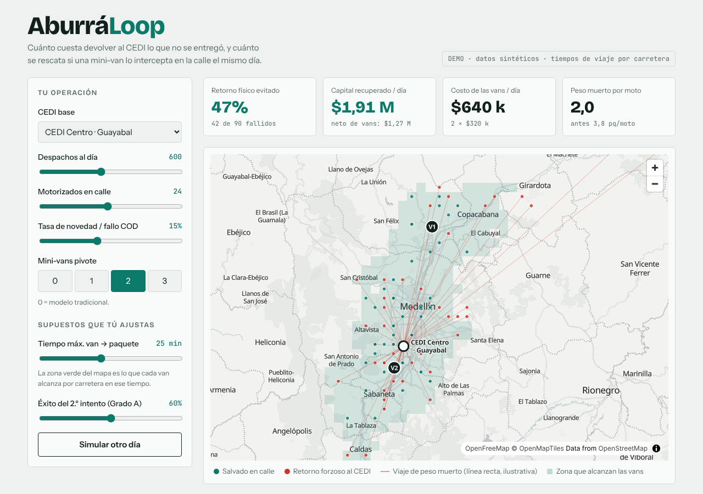

# AburráLoop

Simulador de última milla para comercio electrónico con pago contra entrega (COD) en el Valle de Aburrá.

Compara dos modelos:

- **Tradicional:** los paquetes fallidos vuelven como peso muerto al CEDI.
- **Nodos móviles de triaje:** mini-vans pivote interceptan la novedad en la calle y re-despachan el mismo día.

**Demo:** https://harelo-dev.github.io/aburraloop/



## Qué calcula

- Retorno físico evitado (% de fallos que no vuelven al CEDI).
- Capital recuperado por día: flete de ida y vuelta ahorrado más margen de los productos rescatados.
- Costo diario de las vans.
- Peso muerto por motorizado: paquetes fallidos que cada moto carga sin punto de descarga intermedio.

La van puede operar de dos formas: **interceptar** los fallos en la calle, o **recorrer** a cada moto una vez en la mañana y otra en la tarde y servir de punto de cierre, de modo que la moto no vuelve al CEDI. Debajo del mapa hay un análisis con cinco vistas, promediadas sobre 8 días simulados:

- **¿Intercepta o recorre?** los dos modos con 1, 2 y 3 vans, lado a lado.
- **Cuántas vans conviene** según el neto diario.
- **Punto de equilibrio:** desde cuántos despachos diarios se paga cada van y cuándo la 2.ª y la 3.ª superan a la anterior.
- **Dónde poner las vans:** fijas por zona, según los fallos de días previos o con conocimiento del día (un techo no alcanzable), con tres criterios: mayor alcance, mayor valor neto o concentración de paquetes.
- **Sensibilidad:** qué supuesto mueve más el resultado.

Los parámetros de entrada son el CEDI base, el volumen diario (150–1.200), la flota (5–45 motos), la tasa de novedad (5–30%) y de 0 a 3 mini-vans. Además se ajustan el tiempo máximo de viaje de la van, la distancia mínima de la van al CEDI, el éxito del segundo intento, qué parte del margen se pierde si un paquete vuelve al CEDI y el costo del desvío de la moto.

## Usar tus propios datos

El panel «Usa tus propios datos» carga un CSV con tus paquetes fallidos y calibra el simulador con ellos. **El archivo se procesa en tu navegador y no se sube a ningún servidor.** Quita nombres y teléfonos antes de cargar: el simulador no los necesita.

Solo la ubicación es obligatoria. Todo lo demás mejora la calibración y, si falta, se completa con los supuestos de la demo y el panel te lo avisa.

| Columna | Para qué sirve |
| --- | --- |
| Latitud y longitud, o coordenadas en una sola columna, o dirección escrita | Dónde falló el paquete. Con coordenadas se usan tal cual; una dirección solo se busca cuando la fila no trae coordenadas |
| Municipio o ciudad | Mejora la búsqueda de direcciones y sirve de respaldo cuando una dirección no se encuentra |
| Fecha y hora (juntas o separadas) | Cuántos días cubre el archivo, y a qué hora ocurrió cada fallo. La hora decide cuánto sirve un reintento |
| Valor del pedido (COD) | El valor que se rescata |
| Motivo de la novedad | Se clasifica en A (reintento viable), B (liquidación flash) o C (vuelve al CEDI). La clasificación se sugiere y se puede corregir |
| ¿Se entregó en el reintento? | Calibra el éxito del segundo intento, para A y para B |
| Mensajero o moto | Cuenta cuántas motos tienes |

Acepta `,` `;` tabulador o `|` como separador, decimales con punto o con coma, valores como `$ 120.000`, fechas día primero (`10/03/2026`) o ISO, horas de 24 horas o con AM/PM, y archivos UTF-8 o Windows-1252 (el «CSV» de Excel en español). Un archivo de fallos no dice cuántos paquetes se despacharon, así que ese número se pide para calcular la tasa de novedad.

**Direcciones escritas.** Se pueden ubicar con [Nominatim](https://nominatim.org/) de OpenStreetMap, un servicio público que se usa a una consulta por segundo y solo si lo aceptas, porque las direcciones salen de tu navegador. Entiende calles y barrios, pero casi nunca el número de puerta, así que la ubicación es aproximada y el panel muestra cuántas filas quedaron por número, por calle, por barrio o solo por municipio. Lo ya buscado se recuerda en tu navegador, con un botón para borrarlo. Si tu archivo ya trae coordenadas, o puedes ubicarlas con otra herramienta, el resultado será más preciso.

Hay un archivo de ejemplo en el mismo panel, para probarlo sin datos propios.

## Cómo funciona

- Los incidentes se generan con una semilla fija, así que la misma configuración da el mismo resultado.
- El alcance de una van se mide en **minutos por carretera**, no en radio en línea recta. En un valle largo y angosto la diferencia es grande.
- Los tiempos salen de matrices precalculadas con OSRM (`src/data/`), así que la app es 100% estática.
- El mapa usa [MapLibre GL](https://maplibre.org/) con tiles de [OpenFreeMap](https://openfreemap.org/).

Todos los supuestos y sus límites están en [ASSUMPTIONS.md](ASSUMPTIONS.md). **Son datos sintéticos**: la simulación muestra cómo se comporta la idea, no predice una operación concreta.

## Desarrollo

```bash
npm install
npm run dev          # servidor de desarrollo
npm test             # tests de la simulación
npm run build        # typecheck + build de producción
npm run build:matrix     # tiempos desde zonas y CEDIs (servidor demo de OSRM)
npm run build:cellmatrix # tiempos entre todas las celdas (tarda unos 3 minutos)
```

Requiere Node 20 o superior.

## Stack

Vite, React, TypeScript, MapLibre GL, Vitest.

## Licencia

[MIT](LICENSE) © Haider Rendón
